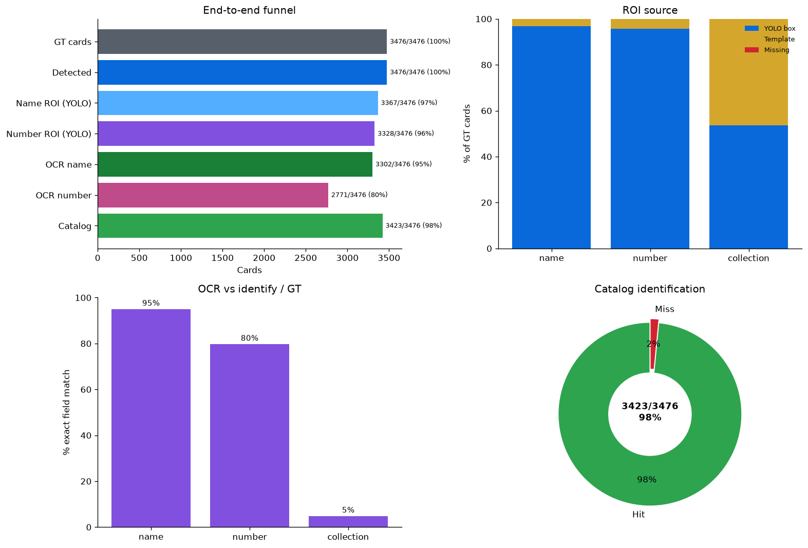
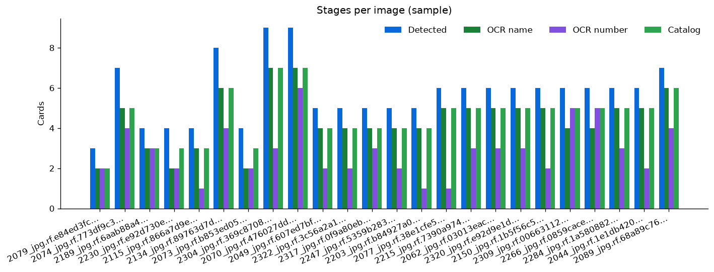
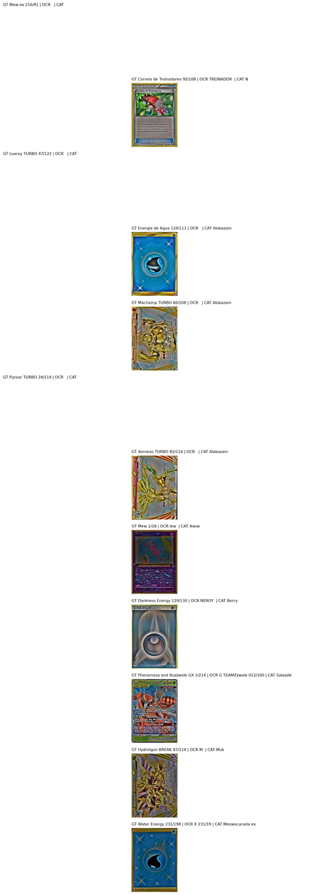

# Pipeline — avaliação ponta a ponta

Relatório gerado por `python pipeline.py`. Mesmo formato dos treinos (`train/detector`, `train/roi`, `train/ocr`). Figuras em `figures/`, tabelas em `tables/`, PDFs em `pdfs/`.

## Configuração

| Item | Valor |
| --- | --- |
| Fonte | `identify` · `data/identify/test/images` |
| Catálogo | `en` |
| Detector | `obb-v6.pt` · conf `0.8` · imgsz `960` |
| ROI | `ocr-roi-v3.pt` · conf `0.4` |
| OCR | RapidOCR (Paddle ONNX) |
| Dispositivo | `0` |

A eleição dos pesos (obb-v6 / ocr-roi-v3) está nos READMEs de `train/`.

## Resultado

**Catalog hit 3423/3476 (98.5%)**. Um acerto é nome (PT ou EN) **ou** número batendo com a linha do ground truth.

## Métricas por etapa

### Cards

| Métrica | Valor |
| --- | --- |
| detected / GT (recall) | 100.0% |
| precision (IoU match) | 100.0% |
| F1 detection | 100.0% |
| extra detections (no GT) | 0 |

### ROI name

| Métrica | Valor |
| --- | --- |
| % detector box | 96.9% |
| % template fallback | 3.1% |

### ROI number

| Métrica | Valor |
| --- | --- |
| % detector box | 95.7% |
| % template fallback | 4.3% |

### ROI collection

| Métrica | Valor |
| --- | --- |
| % detector box | 53.6% |
| % template fallback | 46.4% |

### OCR name

| Métrica | Valor |
| --- | --- |
| accuracy | 95.0% |
| mean CER | 0.060 |

### OCR number

| Métrica | Valor |
| --- | --- |
| accuracy | 79.7% |
| mean CER | 0.168 |

### OCR collection

| Métrica | Valor |
| --- | --- |
| accuracy vs set name | 4.8% |

### End-to-end

| Métrica | Valor |
| --- | --- |
| catalog hit | 98.5% |

## Figuras

**Funil, ROI, OCR e catálogo**

**Etapas por imagem**

**Erros**

## PDFs

| Arquivo | Conteúdo |
| --- | --- |
| [`pdfs/01_obb.pdf`](pdfs/01_obb.pdf) | caixas OBB em cada foto |
| [`pdfs/03_acertos.pdf`](pdfs/03_acertos.pdf) | acertos: crop + faixas ROI |
| [`pdfs/03_erros.pdf`](pdfs/03_erros.pdf) | erros: crop + LIDO × CORRETO |

## CSVs

| Arquivo | Conteúdo |
| --- | --- |
| [`tables/pipeline_metrics.csv`](tables/pipeline_metrics.csv) | resumo por etapa |
| [`tables/pipeline_eval.csv`](tables/pipeline_eval.csv) | uma linha por carta (GT × OCR × catálogo) |
| [`tables/pipeline_extract.csv`](tables/pipeline_extract.csv) | OCR + match (`orient_deg` 0 ou 180) |
| [`tables/pipeline_errors.csv`](tables/pipeline_errors.csv) | só os misses |
