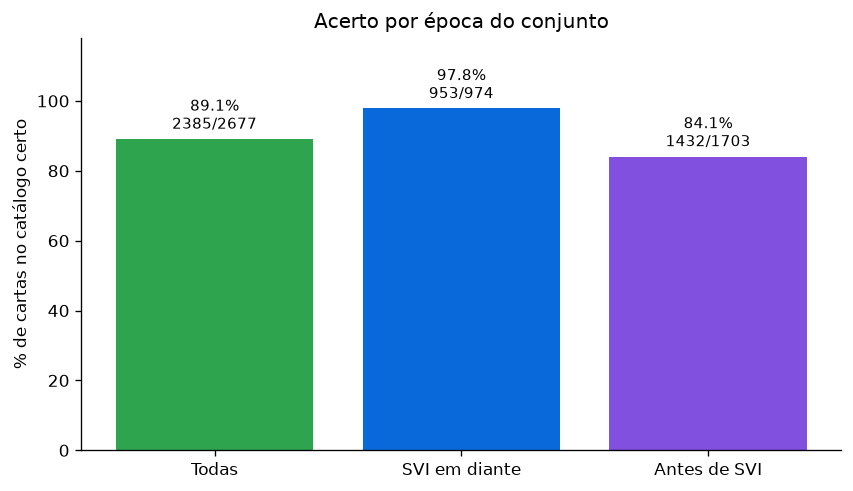

# Pipeline — avaliação ponta a ponta

Relatório gerado por `python pipeline.py`. Ele mede o caminho inteiro: achar a carta na foto, ler o texto e apontar a linha certa do catálogo.

## O que foi feito

Cada foto do conjunto de avaliação entra sozinha. O detector marca as cartas, mesmo tortas. Cada carta é recortada no tamanho físico, 63×88 mm. O segundo modelo marca as faixas de nome, número e coleção, nas duas orientações (em pé e de cabeça para baixo), e fica a que coloca o nome acima do número. O RapidOCR lê essas faixas. Uma nota escolhe a carta no catálogo.

Um acerto é o número e o conjunto da carta escolhida iguais aos da anotação. O nome em português ou inglês não entra nessa conta, porque a mesma carta muda de idioma.

Quando várias cartas da mesma foto já fecharam o número lido com o número escolhido, e pelo menos 65% delas apontam o mesmo conjunto, as outras cartas dessa foto sem coleção lida são procuradas de novo só nesse conjunto. Se a nota empata, ganha quem tem mais dígitos em comum com o número lido. Se a quantidade de dígitos também empata, ganha a menor diferença entre os dois números.

## Configuração

| Item | Valor |
| --- | --- |
| Fonte | `identify` · `data/identify/test/images` |
| Catálogo | `en` |
| Detector | `obb-v6.pt` · conf `0.8` · imgsz `960` |
| ROI | `ocr-roi-v3.pt` · conf `0.4` |
| OCR | RapidOCR (Paddle ONNX) |
| Dispositivo | `0` |

A escolha das redes está nos relatórios de `train/detector` e `train/roi`. A escolha do leitor de texto está em `train/ocr`. Os pesos da nota estão em `train/catalog`.

## Resultado

**2385/2677 (89.1%)** das cartas anotadas saíram com o número e o conjunto certos.

De Scarlet & Violet em diante (o código SVI e os conjuntos que vieram depois), o acerto é **953/974 (97.8%)**. Nessas coleções o código do conjunto vem impresso na carta. Nas coleções anteriores, **1432/1703 (84.1%)**.

Quando o número foi lido certo, o catálogo acertou **2057/2064 (99.7%)**. Quando o número saiu errado, o acerto cai para **328/613 (53.5%)**. Das 292 cartas erradas, 241 ainda tinham o nome certo: o que falta, na maior parte, é o número.

Em **213/374 (57.0%)** das fotos, todas as cartas da imagem acertaram.

O símbolo da coleção, comparado ao código do conjunto, acerta **223/974 (22.9%)** nas cartas de SVI em diante. Nas coleções anteriores essa leitura não tem um código impresso para conferir, então o número geral da coleção fica baixo e não descreve essas cartas novas.

## Como ler as etapas

- **Detected**: a carta foi encontrada na foto e a caixa cobre a carta anotada.
- **Precision**: das caixas desenhadas, a fração que corresponde a uma carta anotada. Extra detections são caixas sem carta anotada.
- **ROI detector / template**: a faixa veio do segundo modelo, ou de um molde fixo quando o modelo não marcou aquela faixa.
- **OCR accuracy**: o texto lido, depois da limpeza, é igual ao anotado naquela faixa.
- **CER**: fração de caracteres que precisariam ser corrigidos. Zero é uma leitura perfeita. 0,200 quer dizer que cerca de um quinto dos caracteres está errado.
- **Catalog hit**: a carta escolhida no catálogo é a anotada. É o número que resume a pipeline.

## Métricas por etapa

### Cards

| Métrica | Valor |
| --- | --- |
| detected / GT (recall) | 100.0% |
| precision (IoU match) | 100.0% |
| F1 detection | 100.0% |
| extra detections (no GT) | 0 |

### ROI name

| Métrica | Valor |
| --- | --- |
| % detector box | 98.8% |
| % template fallback | 1.1% |

### ROI number

| Métrica | Valor |
| --- | --- |
| % detector box | 95.9% |
| % template fallback | 4.0% |

### ROI collection

| Métrica | Valor |
| --- | --- |
| % detector box | 36.3% |
| % template fallback | 63.7% |

### OCR name

| Métrica | Valor |
| --- | --- |
| accuracy | 88.9% |
| mean CER | 0.196 |

### OCR number

| Métrica | Valor |
| --- | --- |
| accuracy | 77.1% |
| mean CER | 0.224 |

### OCR collection

| Métrica | Valor |
| --- | --- |
| accuracy vs set name | 8.3% |
| accuracy vs set name (SVI em diante) | 22.9% |

### End-to-end

| Métrica | Valor |
| --- | --- |
| catalog hit | 89.1% |
| catalog hit (SVI em diante) | 97.8% |
| catalog hit (antes de SVI) | 84.1% |
| catalog hit (número lido certo) | 0.997 |
| catalog hit (número lido errado) | 53.5% |
| fotos com todas as cartas certas | 0.570 |

## Figuras

**Funil, ROI, OCR e catálogo**

**Acerto por época do conjunto**

**Etapas por imagem**

**Erros**

## PDFs

| Arquivo | Conteúdo |
| --- | --- |
| [`pdfs/01_obb.pdf`](pdfs/01_obb.pdf) | caixas OBB em cada foto |
| [`pdfs/03_acertos.pdf`](pdfs/03_acertos.pdf) | acertos: crop + faixas ROI |
| [`pdfs/03_erros.pdf`](pdfs/03_erros.pdf) | erros: crop + LIDO × CORRETO |

## CSVs

| Arquivo | Conteúdo |
| --- | --- |
| [`tables/pipeline_metrics.csv`](tables/pipeline_metrics.csv) | resumo por etapa |
| [`tables/pipeline_eval.csv`](tables/pipeline_eval.csv) | uma linha por carta (GT × OCR × catálogo) |
| [`tables/pipeline_extract.csv`](tables/pipeline_extract.csv) | OCR + match (`orient_deg` 0 ou 180) |
| [`tables/pipeline_errors.csv`](tables/pipeline_errors.csv) | só os misses |
