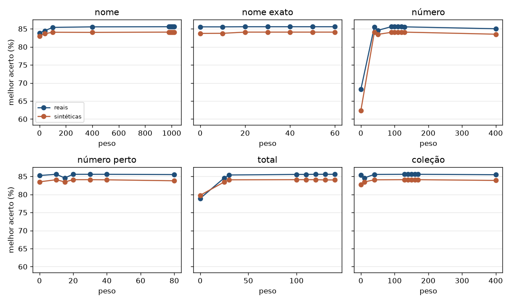
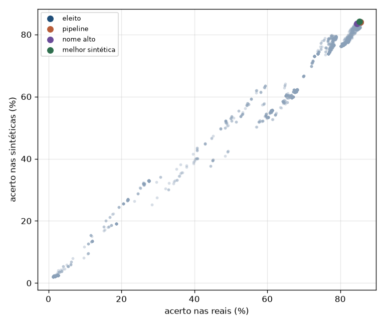
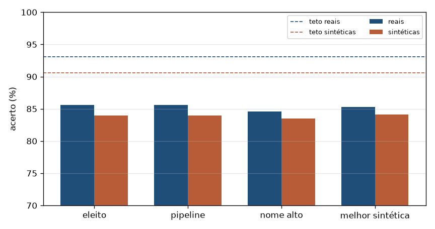

# Catálogo — pesos da decisão

Relatório gerado por `python -m train catalog`. Não treina rede: compara pesos da escolha da carta no catálogo em cima das leituras já gravadas.

O peso que a pipeline e o site usam é o marcado como `atual` em `pipeline.py` e em `ptcg_api/catalog.py`. A grade pode apontar outro peso. Ele só substitui o atual se a diferença nas fotos reais for clara.

## O que esta conta faz

Depois que o OCR lê a carta, uma nota escolhe a linha do catálogo. A nota soma o quanto o nome parece, se o número de colecionador bate, se o total depois da barra bate e se a coleção bate. Cada parcela tem um peso. Este relatório experimenta combinações desses pesos.

Um acerto é o número e o conjunto iguais à carta verdadeira. O nome em português ou inglês não entra, porque a mesma carta muda de idioma. Sem um número de colecionador na leitura, a carta conta como erro: a conta não chuta.

Se duas cartas ficam com a mesma nota, ganha a que tem mais dígitos em comum com o número lido. Se a quantidade de dígitos também empata, ganha a menor diferença entre os dois números. A ordem do arquivo só decide o que ainda sobrar.

As fotos reais são as leituras gravadas pela pipeline. As sintéticas são cartas do catálogo que não apareceram nessas fotos, com um erro parecido com o do OCR, para ver se o peso funciona fora das fotos que já temos. A eleição olha as fotos reais. As sintéticas ficam ao lado e não escolhem o peso.

Scarlet & Violet, código SVI, é o ponto em que o conjunto passa a vir impresso como texto. As coleções anteriores quase não têm esse código, então a leitura sintética da coleção só é gerada de SVI em diante.

## Ambiente

| Item | Valor |
| --- | --- |
| Data/hora | 2026-11-08 20:48:13 |
| SO | Windows 11 |
| Python | 3.14.7 |
| PyTorch | 2.11.0+cu128 |
| Ultralytics | 8.4.173 |
| CUDA disponível | True |
| CUDA (compilado) | 12.8 |
| GPU | NVIDIA GeForce RTX 5060 |
| VRAM | 8.0 GB |
| Dispositivo de treino | 0 |
| cuDNN | True |
| cwd | C:\Users\Pichau\OneDrive\Documentos\Repositorios\TCGTradeSegmentacao |
| runs_dir | C:\Users\Pichau\OneDrive\Documentos\Repositorios\TCGTradeSegmentacao\runs\catalog |
| weights_dir | C:\Users\Pichau\OneDrive\Documentos\Repositorios\TCGTradeSegmentacao\pretrained |

## Protocolo

- Fonte das leituras reais: `output/tables/pipeline_eval.csv` · split `identify/test`.
- Cada linha junta o texto lido (`ocr_name`, `ocr_number`, `ocr_collection`) à carta do catálogo com o mesmo número e a mesma coleção.
- Acerto: o primeiro lugar tem o mesmo número e a mesma coleção da anotação. Nome em português ou inglês não entra.
- Sem número de colecionador na leitura, a carta conta como erro.
- O arquivo não guarda `sample_id` nem o nome da foto.
- A linha sintética é uma carta do catálogo que não estava na leitura. O erro copia o padrão real: nome quase igual, número exato na maior parte, e o resto sem número ou com o total ou o colecionador deslocado.
- `ocr_collection` sintético fica vazio antes de SVI. De Scarlet & Violet em diante o código é texto, e a leitura repete o OCR: vazio, o código, o código com PT ou EN, ou uma letra trocada.
- A grade cruza todos os eixos, do zero até um peso alto: name_w (0, 100, 250, 400, 700, 1000); name_exact (0, 10, 40, 100); number_w (0, 40, 110, 250, 500); number_near (0, 20, 40, 80); total_w (0, 30, 120, 250); set_w (0, 40, 150, 400, 800).
- `atual` é o peso da pipeline e do site. `nome_alto` é a conta antiga, com nome até 1000.
- O veredito elege o maior acerto nas leituras reais. Empate prefere o maior peso de número e, depois, o de coleção. As sintéticas entram no relatório ao lado, e não decidem o peso.
- Depois da grade, cada peso do eleito anda de 10 em 10, de -20 a +20.

## O arquivo

| | Reais | Sintéticas | Todas |
| --- | --- | --- | --- |
| Cartas | 2677 | 6058 | 8735 |
| No `cards.csv` | 2677 | 6058 | 8735 |
| De SVI em diante | 974 | 3700 | 4674 |
| Com coleção lida | 814 | 3122 | 3936 |
| Com número lido | 2230 | 5009 | 7239 |
| Carta certa entre os candidatos | 2492/2677 (93.09%) | 5486/6058 (90.56%) | 7978/8735 (91.33%) |

A última linha é o teto desta conta. A soma linear não passa disso: se a carta certa não está no grupo, nenhum peso a escolhe.

## Veredito

O peso eleito pelas fotos reais é name_w 700, name_exact 30, number_w 110, number_near 20, total_w 120, set_w 170. Ele acerta 2338/2677 (87.34%) das leituras reais e 5115/6058 (84.43%) das sintéticas. Nas duas juntas, 7453/8735 (85.32%).

Nota igual fica com quem tem mais dígitos em comum com o colecionador lido. Se a quantidade empata, fica a menor diferença absoluta. A grade usa esse desempate.

O peso que está na pipeline acerta 2337/2677 (87.30%) das reais e 5099/6058 (84.17%) das sintéticas. A conta antiga, com o nome até 1000, acerta 2312/2677 (86.37%) das reais e 5083/6058 (83.91%) das sintéticas.

Nas sintéticas o melhor seria name_w 400, name_exact 100, number_w 40, number_near 20, total_w 120, set_w 150, com 5123/6058 (84.57%) nelas e 2322/2677 (86.74%) nas reais. A eleição fica com as fotos, porque as sintéticas repetem um padrão de erro e têm mais cartas de SVI em diante.

## Gráficos

Melhor acerto em cada valor de peso. Os outros pesos variam juntos.

Cada ponto é uma combinação de pesos.

Pesos de referência. A linha tracejada é o teto: a carta certa está entre as candidatas.

## Resultado

| label | reais | sinteticas | todas | name_w | name_exact | number_w | number_near | total_w | set_w |
| --- | --- | --- | --- | --- | --- | --- | --- | --- | --- |
| melhor | 87.34% | 84.43% | 85.32% | 700 | 30 | 110 | 20 | 120 | 170 |
| local | 87.34% | 84.43% | 85.32% | 700 | 40 | 110 | 20 | 120 | 170 |
| local | 87.34% | 84.43% | 85.32% | 700 | 50 | 110 | 20 | 120 | 170 |
| local | 87.34% | 84.43% | 85.32% | 700 | 60 | 110 | 20 | 120 | 170 |
| local | 87.34% | 84.43% | 85.32% | 710 | 30 | 110 | 20 | 120 | 170 |
| local | 87.34% | 84.43% | 85.32% | 710 | 40 | 110 | 20 | 120 | 170 |
| local | 87.34% | 84.43% | 85.32% | 710 | 50 | 110 | 20 | 120 | 170 |
| local | 87.34% | 84.43% | 85.32% | 710 | 60 | 110 | 20 | 120 | 170 |
| atual | 87.30% | 84.17% | 85.13% | 1000 | 30 | 120 | 30 | 130 | 170 |
| melhor_sintetica | 86.74% | 84.57% | 85.23% | 400 | 100 | 40 | 20 | 120 | 150 |
| nome_alto | 86.37% | 83.91% | 84.66% | 1000 | 40 | 50 | 15 | 25 | 10 |

Tabela completa: [`ranking.csv`](ranking.csv).
