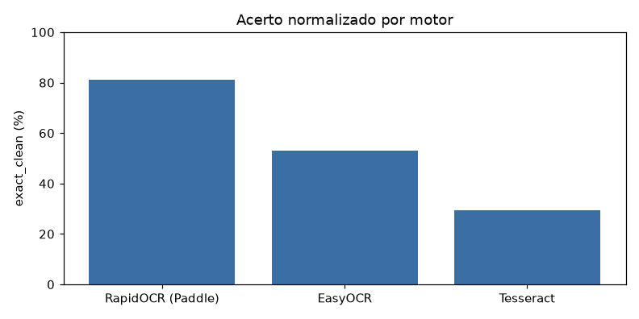
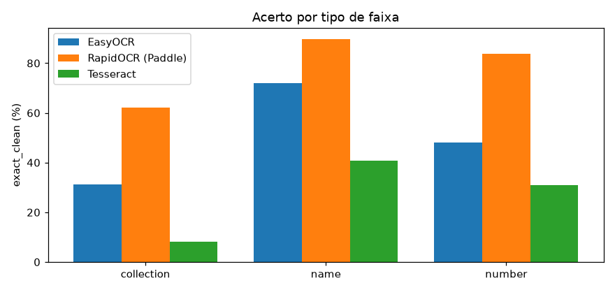
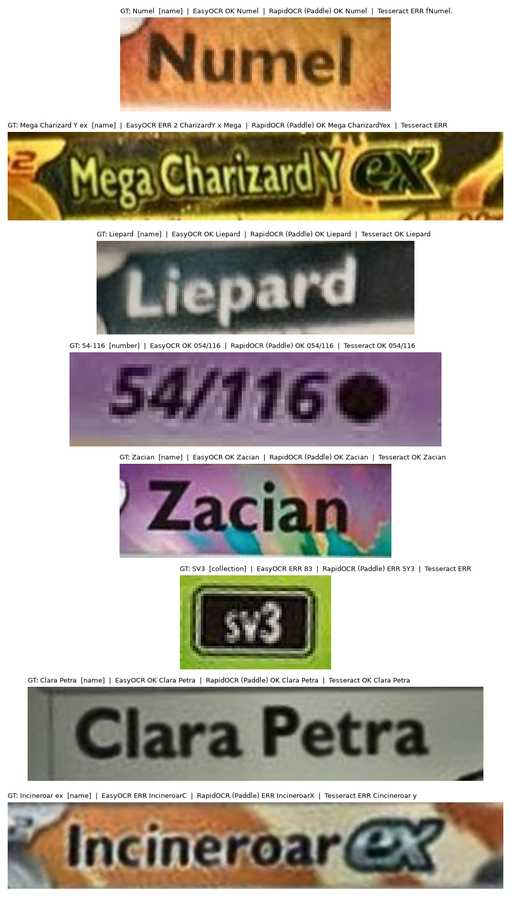

# ocr-cmp-v1 — comparação de motores de OCR

Relatório gerado por `python -m train ocr`. **Não treina** um reconhecedor: compara EasyOCR, RapidOCR (Paddle ONNX) e Tesseract nas caixas anotadas de `data/ocr/`. O detector de ROI não entra neste laço.

Ranking: maior **exact_clean** nas caixas legíveis; empate < 1 p.p. desempata no CER; depois latência.

## Ambiente

| Item | Valor |
| --- | --- |
| Data/hora | 2026-10-15 14:32:00 |
| SO | Windows 11 |
| Python | 3.14.7 |
| PyTorch | 2.11.0+cu128 |
| Ultralytics | 8.4.173 |
| CUDA disponível | True |
| CUDA (compilado) | 12.8 |
| GPU | NVIDIA GeForce RTX 5060 |
| VRAM | 8.0 GB |
| Dispositivo de treino | 0 |
| cuDNN | True |
| cwd | C:\Users\Pichau\Documents\Repositorios\TCGTradeSegmentacao |
| runs_dir | C:\Users\Pichau\Documents\Repositorios\TCGTradeSegmentacao\runs\ocr |
| weights_dir | C:\Users\Pichau\Documents\Repositorios\TCGTradeSegmentacao\models |

## Protocolo

- A classe YOLO é o texto impresso (não name/number/colection).
- exact_clean usa os limpadores de `read_card.py` (o que o pipeline veria).
- Caixas `--` / ilegíveis saem do ranking.
- Caixas legíveis no ranking: **664**. Ilegíveis (fora do ranking): 35.

## Ranking (todas as engines)

| winner | motor | exact_clean | exact_raw | CER_clean | CER_raw | vazio_% | ms/caixa | n | WER_nome |
| --- | --- | --- | --- | --- | --- | --- | --- | --- | --- |
| ← | RapidOCR (Paddle) | 81.17 | 79.67 | 0.1538 | 0.1453 | 7.9800 | 11.70 | 664 | 0.2538 |
|  | EasyOCR | 53.01 | 50.90 | 0.3299 | 0.3047 | 16.57 | 35.30 | 664 | 0.2955 |
|  | Tesseract | 29.52 | 25.90 | 0.6020 | 0.5900 | 51.51 | 104.90 | 664 | 0.6043 |

## Motor eleito

**RapidOCR (Paddle)** entra em `src/ocr/read_card.py` e no pipeline. EasyOCR e Tesseract ficam como baseline deste *benchmark*.

## Acerto por tipo de faixa

| tipo | n | EasyOCR | RapidOCR (Paddle) | Tesseract |
| --- | --- | --- | --- | --- |
| collection | 148 | 31.10 | 62.20 | 8.1000 |
| name | 242 | 71.90 | 89.70 | 40.90 |
| number | 274 | 48.20 | 83.90 | 31.00 |

## Figuras

**Acerto exact_clean**

**Acerto por tipo**

**Amostras**

