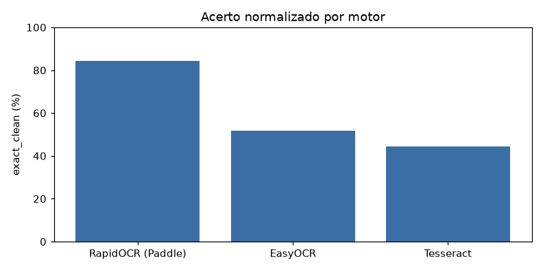
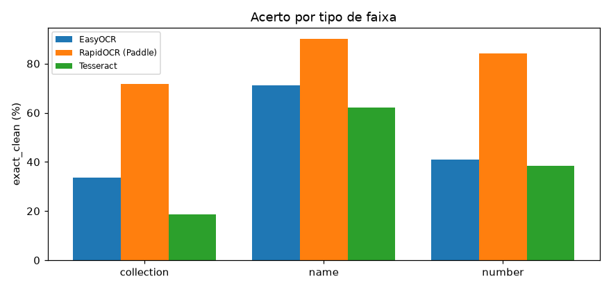
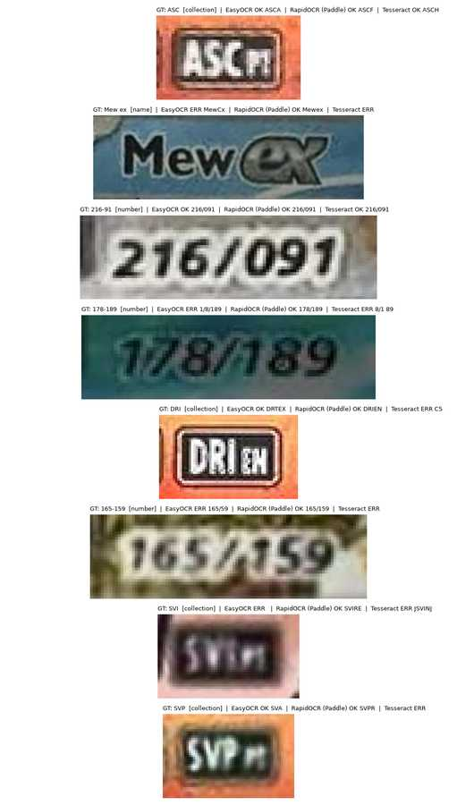
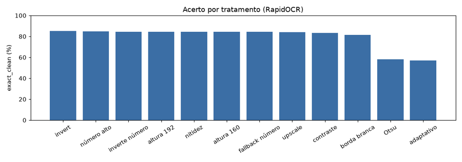
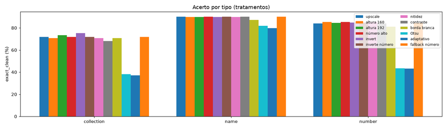
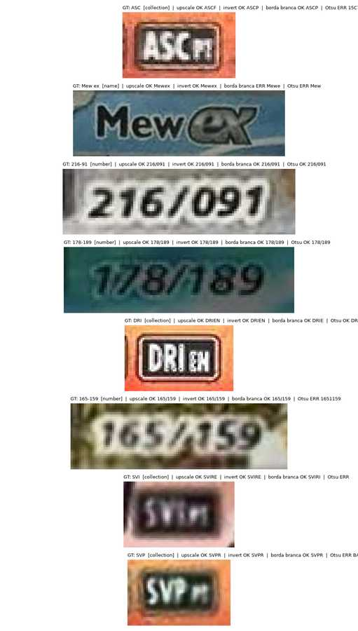
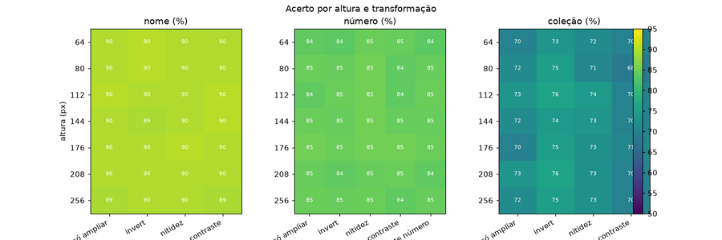

# ocr-cmp-v1 — motores e tratamentos de faixa

Relatório gerado por `python -m train ocr`. **Não treina** um reconhecedor: compara motores (EasyOCR, RapidOCR, Tesseract) **e** pré-processamentos da faixa nas caixas anotadas de `data/ocr/`. O detector de ROI não entra neste laço.

Ranking: maior **exact_clean** nas caixas legíveis; empate < 1 p.p. desempata no CER; depois latência.

## Ambiente

| Item | Valor |
| --- | --- |
| Data/hora | 2026-11-08 18:07:43 |
| SO | Windows 11 |
| Python | 3.14.7 |
| PyTorch | 2.11.0+cu128 |
| Ultralytics | 8.4.173 |
| CUDA disponível | True |
| CUDA (compilado) | 12.8 |
| GPU | NVIDIA GeForce RTX 5060 |
| VRAM | 8.0 GB |
| Dispositivo de treino | 0 |
| cuDNN | True |
| cwd | C:\Users\Pichau\OneDrive\Documentos\Repositorios\TCGTradeSegmentacao |
| runs_dir | C:\Users\Pichau\OneDrive\Documentos\Repositorios\TCGTradeSegmentacao\runs\ocr |
| weights_dir | C:\Users\Pichau\OneDrive\Documentos\Repositorios\TCGTradeSegmentacao\pretrained |

## Protocolo

- A classe YOLO é o texto impresso (não name/number/colection).
- exact_clean usa os limpadores de `read_card.py` (o que o pipeline veria).
- Caixas `--` / ilegíveis saem do ranking.
- Motores e produção leem por `prepare_strip` / `read_strip_raw` em `read_card.py`.
- Produção hoje é só upscale. Altura 160, altura 192, número alto, invert, inverte número, nitidez, contraste, borda branca, Otsu e adaptativo entram na rodada 1.
- Fallback número lê de novo quando a primeira leitura não parece um colecionador (invertido, altura 160, os dois).
- A busca gulosa parte da melhor técnica de pixel. Não mistura duas alturas nem dois inverts, e não entra no fallback.
- No fim, a mistura e o fallback são confrontados com o upscale de produção.
- Só vale a pena (e entra na pipeline) com ganho ≥ 2 p.p. e nenhum tipo de faixa caindo ≥ 1 p.p.
- A grade de altura (64 a 256) cruza invert, nitidez e contraste. O número também testa o invert só nele. Cada campo pode eleger a sua célula.
- Caixas legíveis no ranking: **594**. Ilegíveis (fora do ranking): 0.

## Ranking (motores)

| winner | motor | exact_clean | exact_raw | CER_clean | CER_raw | vazio_% | ms/caixa | n | WER_nome |
| --- | --- | --- | --- | --- | --- | --- | --- | --- | --- |
| ← | RapidOCR (Paddle) | 84.18 | 84.18 | 0.1054 | 0.1049 | 3.2000 | 13.00 | 594 | 0.2517 |
|  | EasyOCR | 51.85 | 51.85 | 0.2977 | 0.2977 | 3.8700 | 46.00 | 594 | 0.3017 |
|  | Tesseract | 44.28 | 44.28 | 0.3902 | 0.3902 | 21.38 | 127.30 | 594 | 0.4174 |

## Motor eleito

**RapidOCR (Paddle)** entra em `src/ocr/read_card.py` e no pipeline. EasyOCR e Tesseract ficam como baseline. A faixa de produção só muda se a mistura vencedora valer a pena (seção no fim).

## Acerto por tipo de faixa (motores)

| tipo | n | EasyOCR | RapidOCR (Paddle) | Tesseract |
| --- | --- | --- | --- | --- |
| collection | 113 | 33.60 | 71.70 | 18.60 |
| name | 242 | 71.10 | 90.10 | 62.00 |
| number | 239 | 41.00 | 84.10 | 38.50 |

## Ranking (técnicas individuais, RapidOCR fixo)

| winner | motor | exact_clean | exact_raw | CER_clean | CER_raw | vazio_% | ms/caixa | n | WER_nome |
| --- | --- | --- | --- | --- | --- | --- | --- | --- | --- |
| ← | invert | 85.02 | 85.02 | 0.1019 | 0.1008 | 3.0300 | 12.10 | 594 | 0.2517 |
|  | número alto | 84.68 | 84.68 | 0.1049 | 0.1044 | 3.2000 | 12.20 | 594 | 0.2517 |
|  | inverte número | 84.51 | 84.51 | 0.1062 | 0.1057 | 3.2000 | 12.00 | 594 | 0.2517 |
|  | altura 192 | 84.51 | 84.51 | 0.1059 | 0.1042 | 3.3700 | 12.30 | 594 | 0.2517 |
|  | nitidez | 84.34 | 84.34 | 0.1059 | 0.1042 | 3.2000 | 12.00 | 594 | 0.2497 |
|  | altura 160 | 84.34 | 84.34 | 0.1066 | 0.1043 | 3.3700 | 12.50 | 594 | 0.2517 |
|  | fallback número | 84.34 | 84.34 | 0.1052 | 0.1046 | 3.2000 | 12.30 | 594 | 0.2517 |
|  | upscale | 84.18 | 84.18 | 0.1054 | 0.1049 | 3.2000 | 12.10 | 594 | 0.2517 |
|  | contraste | 83.50 | 83.50 | 0.1128 | 0.1099 | 3.8700 | 11.90 | 594 | 0.2517 |
|  | borda branca | 81.65 | 81.65 | 0.1219 | 0.1202 | 4.0400 | 11.90 | 594 | 0.2479 |
|  | Otsu | 58.08 | 58.08 | 0.2853 | 0.2836 | 10.27 | 11.90 | 594 | 0.2376 |
|  | adaptativo | 56.90 | 56.90 | 0.2573 | 0.2545 | 6.2300 | 12.20 | 594 | 0.2483 |

## Técnica eleita (rodada 1)

**invert** foi a melhor técnica sozinha. A busca gulosa mistura passos de pixel em cima da melhor técnica que não é o fallback.

## Acerto por tipo de faixa (tratamentos)

| tipo | n | upscale | altura 160 | altura 192 | número alto | invert | inverte número | nitidez | contraste | borda branca | Otsu | adaptativo | fallback número |
| --- | --- | --- | --- | --- | --- | --- | --- | --- | --- | --- | --- | --- | --- |
| collection | 113 | 71.70 | 70.80 | 73.50 | 71.70 | 75.20 | 71.70 | 70.80 | 68.10 | 70.80 | 38.10 | 37.20 | 71.70 |
| name | 242 | 90.10 | 89.70 | 89.70 | 90.10 | 89.70 | 90.10 | 89.70 | 90.10 | 87.20 | 81.80 | 79.80 | 90.10 |
| number | 239 | 84.10 | 85.40 | 84.50 | 85.40 | 84.90 | 84.90 | 85.40 | 84.10 | 81.20 | 43.50 | 43.10 | 84.50 |

## Busca gulosa (mistura final)

As cinco técnicas entram sozinhas na tabela acima. A melhor vira a raiz. Cada ramo mistura uma das que faltam: se o exact_clean **piorar**, o ramo para; se **melhorar**, continua com as restantes. O relatório traz o caminho percorrido, não o produto cartesiano.

### Caminho

- Raiz da busca: **upscale + invert** (85.02%), eleita entre as cinco técnicas individuais.
- `upscale` já entra em todas as técnicas (redimensionar a faixa); não é um passo extra neste ramo.
  - `upscale + invert + altura 160`: 84.85% (piorou vs 85.02%; ramo parado)
  - `upscale + invert + altura 192`: 84.68% (piorou vs 85.02%; ramo parado)
  - `upscale + invert + número alto`: 85.02% (piorou vs 85.02%; ramo parado)
  - `upscale + invert + nitidez`: 84.85% (piorou vs 85.02%; ramo parado)
  - `upscale + invert + contraste`: 83.67% (piorou vs 85.02%; ramo parado)
  - `upscale + invert + borda branca`: 81.48% (piorou vs 85.02%; ramo parado)
  - `upscale + invert + Otsu`: 57.91% (piorou vs 85.02%; ramo parado)
  - `upscale + invert + adaptativo`: 51.85% (piorou vs 85.02%; ramo parado)
- fallback número: 84.34% (+0.16 p.p. vs upscale). Ganho +0.16 p.p. < 2 p.p. (SE ≈ 1.5 p.p.).

### Mistura final

**upscale + invert (85.02%)**.

## Vale a pena?

**Não vale.** Ganho +0.84 p.p. < 2 p.p. (SE ≈ 1.5 p.p.).

Critério: ganho de exact_clean ≥ **2 p.p.** sobre o upscale e nenhum tipo de faixa cair ≥ **1 p.p.**

| | upscale (produção) | mistura | Δ |
| --- | --- | --- | --- |
| exact_clean (%) | 84.18 | 85.02 | +0.84 |
| caixas (n=594) | — | — | +5 |
| só a mistura acerta | — | 10 | — |
| só o upscale acerta | 5 | — | — |

| tipo | upscale | mistura | Δ |
| --- | --- | --- | --- |
| collection | 71.7 | 75.2 | +3.5 |
| name | 90.1 | 89.7 | -0.4 |
| number | 84.1 | 84.9 | +0.8 |

Checagens:

- [falhou] ganho +0.84 p.p. < 2 p.p. (SE ≈ 1.5 p.p.)
- [ok] nenhum tipo caiu ≥ 1 p.p.

## Figuras

**Acerto normalizado por motor**

**Acerto por tipo de faixa**

**Amostras**

**Acerto por tratamento (RapidOCR)**

**Acerto por tipo (tratamentos)**

**Amostras (tratamentos)**

## Altura × transformação por campo

Cada célula é o `exact_clean` daquela altura com aquela transformação. Nome, número e coleção são medidos à parte, então cada um pode ficar com uma combinação diferente. A base de produção é 112 px no nome e no número e 80 px na coleção, sem transformação extra. Otsu, adaptativo e borda branca ficam de fora: no sweep anterior caíram cerca de 25 p.p. Um campo só entra na pipeline se o ganho dele for ≥ 2 p.p.

### nome (n=242, base 90.1%)

| altura | só ampliar | invert | nitidez | contraste |
|---:|---:|---:|---:|---:|
| 64 | 89.7 | 90.1 | 89.7 | 89.7 |
| 80 | 89.7 | 90.1 | 89.7 | 89.7 |
| 112 | 90.1 | 89.7 | 89.7 | 90.1 |
| 144 | 89.7 | 89.3 | 89.7 | 90.1 |
| 176 | 89.7 | 89.7 | 90.1 | 89.7 |
| 208 | 89.7 | 89.7 | 89.7 | 89.7 |
| 256 | 89.3 | 89.7 | 89.7 | 89.3 |

Melhor: altura **112** + **só ampliar** = 90.08% (-0.00 p.p., SE 1.9). Não vale.

### número (n=239, base 84.1%)

| altura | só ampliar | invert | nitidez | contraste | inverte número |
|---:|---:|---:|---:|---:|---:|
| 64 | 84.1 | 83.7 | 84.9 | 84.5 | 83.7 |
| 80 | 84.9 | 84.5 | 85.4 | 84.1 | 84.5 |
| 112 | 84.1 | 84.9 | 85.4 | 84.1 | 84.9 |
| 144 | 84.9 | 84.5 | 85.4 | 84.5 | 84.5 |
| 176 | 85.4 | 84.9 | 85.4 | 85.4 | 84.9 |
| 208 | 84.5 | 84.1 | 84.5 | 84.9 | 84.1 |
| 256 | 84.9 | 84.5 | 84.9 | 84.1 | 84.5 |

Melhor: altura **176** + **nitidez** = 85.36% (+1.26 p.p., SE 2.4). Não vale.

### coleção (n=113, base 71.7%)

| altura | só ampliar | invert | nitidez | contraste |
|---:|---:|---:|---:|---:|
| 64 | 69.9 | 73.5 | 71.7 | 69.9 |
| 80 | 71.7 | 75.2 | 70.8 | 68.1 |
| 112 | 73.5 | 76.1 | 74.3 | 69.9 |
| 144 | 71.7 | 74.3 | 73.5 | 69.9 |
| 176 | 69.9 | 75.2 | 72.6 | 70.8 |
| 208 | 73.5 | 76.1 | 72.6 | 69.9 |
| 256 | 71.7 | 75.2 | 72.6 | 69.9 |

Melhor: altura **208** + **invert** = 76.11% (+4.43 p.p., SE 4.2). Vale.

Juntando o melhor de cada campo que passa a barra, o acerto geral fica **85.02%** contra **84.18%** da base (+0.84 p.p.). Entra na pipeline: coleção (altura 208 + invert).
