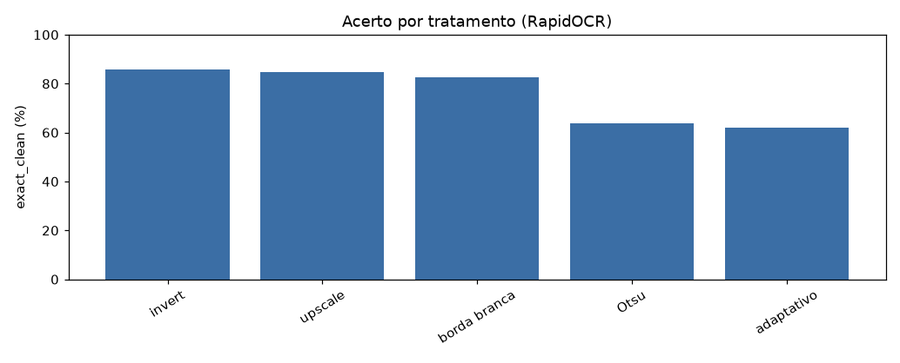
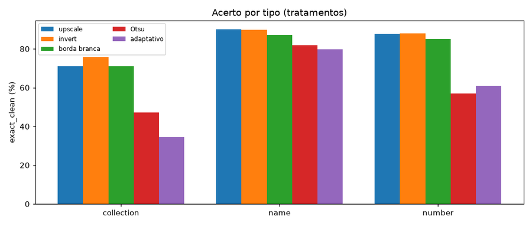

# ocr-cmp-v1 — motores e tratamentos de faixa

Relatório gerado por `python -m train ocr`. **Não treina** um reconhecedor: compara motores (EasyOCR, RapidOCR, Tesseract) **e** pré-processamentos da faixa nas caixas anotadas de `data/ocr/`. O detector de ROI não entra neste laço.

Ranking: maior **exact_clean** nas caixas legíveis; empate < 1 p.p. desempata no CER; depois latência.

## Ambiente

| Item | Valor |
| --- | --- |
| Data/hora | 2026-10-20 16:34:30 |
| SO | Windows 11 |
| Python | 3.14.7 |
| PyTorch | 2.11.0+cu128 |
| Ultralytics | 8.4.173 |
| CUDA disponível | True |
| CUDA (compilado) | 12.8 |
| GPU | NVIDIA GeForce RTX 5060 |
| VRAM | 8.0 GB |
| Dispositivo de treino | 0 |
| cuDNN | True |
| cwd | C:\Users\Pichau\Documents\Repositorios\TCGTradeSegmentacao |
| runs_dir | C:\Users\Pichau\Documents\Repositorios\TCGTradeSegmentacao\runs\ocr |
| weights_dir | C:\Users\Pichau\Documents\Repositorios\TCGTradeSegmentacao\pretrained |

## Protocolo

- A classe YOLO é o texto impresso (não name/number/colection).
- exact_clean usa os limpadores de `read_card.py` (o que o pipeline veria).
- Caixas `--` / ilegíveis saem do ranking.
- Motores e produção usam `enhance_strip` (só upscale, sem CLAHE e sem invert).
- Cinco técnicas individuais (RapidOCR fixo): upscale, invert, borda branca, Otsu, adaptativo.
- A busca gulosa parte da melhor individual e mistura as outras; ramo que piora para.
- No fim, a mistura vencedora é confrontada com o upscale de produção.
- Só vale a pena (e entra em `enhance_strip`) com ganho ≥ 2 p.p. e nenhum tipo caindo ≥ 1 p.p.
- Caixas legíveis no ranking: **664**. Ilegíveis (fora do ranking): 35.

## Ranking (motores)

| winner | motor | exact_clean | exact_raw | CER_clean | CER_raw | vazio_% | ms/caixa | n | WER_nome |
| --- | --- | --- | --- | --- | --- | --- | --- | --- | --- |
| ← | RapidOCR (Paddle) | 84.79 | 83.89 | 0.1251 | 0.1158 | 6.0200 | 11.20 | 664 | 0.2517 |
|  | EasyOCR | 54.82 | 52.26 | 0.3233 | 0.3019 | 15.06 | 35.40 | 664 | 0.3017 |
|  | Tesseract | 47.59 | 43.67 | 0.4086 | 0.4005 | 28.46 | 112.70 | 664 | 0.4174 |

## Motor eleito

**RapidOCR (Paddle)** entra em `src/ocr/read_card.py` e no pipeline. EasyOCR e Tesseract ficam como baseline. A faixa de produção só muda se a mistura vencedora valer a pena (seção no fim).

## Acerto por tipo de faixa (motores)

| tipo | n | EasyOCR | RapidOCR (Paddle) | Tesseract |
| --- | --- | --- | --- | --- |
| collection | 148 | 35.10 | 70.90 | 18.20 |
| name | 242 | 71.10 | 90.10 | 62.00 |
| number | 274 | 51.10 | 87.60 | 50.70 |

## Ranking (técnicas individuais, RapidOCR fixo)

| winner | motor | exact_clean | exact_raw | CER_clean | CER_raw | vazio_% | ms/caixa | n | WER_nome |
| --- | --- | --- | --- | --- | --- | --- | --- | --- | --- |
| ← | invert | 85.84 | 85.09 | 0.1199 | 0.1107 | 5.8700 | 10.70 | 664 | 0.2517 |
|  | upscale | 84.79 | 83.89 | 0.1251 | 0.1158 | 6.0200 | 10.60 | 664 | 0.2517 |
|  | borda branca | 82.68 | 81.63 | 0.1339 | 0.1284 | 6.7800 | 10.70 | 664 | 0.2479 |
|  | Otsu | 63.86 | 61.14 | 0.2787 | 0.2741 | 19.88 | 10.70 | 664 | 0.2376 |
|  | adaptativo | 61.90 | 57.23 | 0.2672 | 0.2627 | 12.80 | 10.70 | 664 | 0.2483 |

## Técnica eleita (rodada 1)

**invert** foi a melhor das cinco técnicas sozinhas e virou a raiz da busca gulosa.

## Acerto por tipo de faixa (tratamentos)

| tipo | n | upscale | invert | borda branca | Otsu | adaptativo |
| --- | --- | --- | --- | --- | --- | --- |
| collection | 148 | 70.90 | 75.70 | 70.90 | 47.30 | 34.50 |
| name | 242 | 90.10 | 89.70 | 87.20 | 81.80 | 79.80 |
| number | 274 | 87.60 | 88.00 | 85.00 | 56.90 | 60.90 |

## Busca gulosa (mistura final)

As cinco técnicas entram sozinhas na tabela acima. A melhor vira a raiz. Cada ramo mistura uma das que faltam: se o exact_clean **piorar**, o ramo para; se **melhorar**, continua com as restantes. O relatório traz o caminho percorrido, não o produto cartesiano.

### Caminho

- Raiz da busca: **upscale + invert** (85.84%), eleita entre as cinco técnicas individuais.
- `upscale` já entra em todas as técnicas (redimensionar a faixa); não é um passo extra neste ramo.
  - `upscale + invert + borda branca`: 83.13% (piorou vs 85.84%; ramo parado)
  - `upscale + invert + Otsu`: 62.65% (piorou vs 85.84%; ramo parado)
  - `upscale + invert + adaptativo`: 58.13% (piorou vs 85.84%; ramo parado)

### Mistura final

**upscale + invert (85.84%)**.

## Vale a pena?

**Não vale.** Ganho +1.05 p.p. < 2 p.p. (SE ≈ 1.4 p.p.).

Critério: ganho de exact_clean ≥ **2 p.p.** sobre o upscale e nenhum tipo de faixa cair ≥ **1 p.p.**

| | upscale (produção) | mistura | Δ |
| --- | --- | --- | --- |
| exact_clean (%) | 84.79 | 85.84 | +1.05 |
| caixas (n=664) | — | — | +7 |
| só a mistura acerta | — | 13 | — |
| só o upscale acerta | 6 | — | — |

| tipo | upscale | mistura | Δ |
| --- | --- | --- | --- |
| collection | 70.9 | 75.7 | +4.8 |
| name | 90.1 | 89.7 | -0.4 |
| number | 87.6 | 88.0 | +0.4 |

Checagens:

- [falhou] ganho +1.05 p.p. < 2 p.p. (SE ≈ 1.4 p.p.)
- [ok] nenhum tipo caiu ≥ 1 p.p.

## Figuras

**Acerto normalizado por motor**

**Acerto por tipo de faixa**

**Amostras**

**Acerto por tratamento (RapidOCR)**

**Acerto por tipo (tratamentos)**

**Amostras (tratamentos)**

